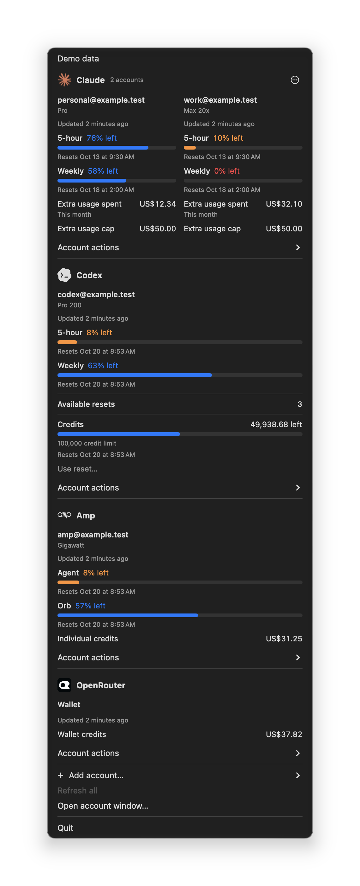
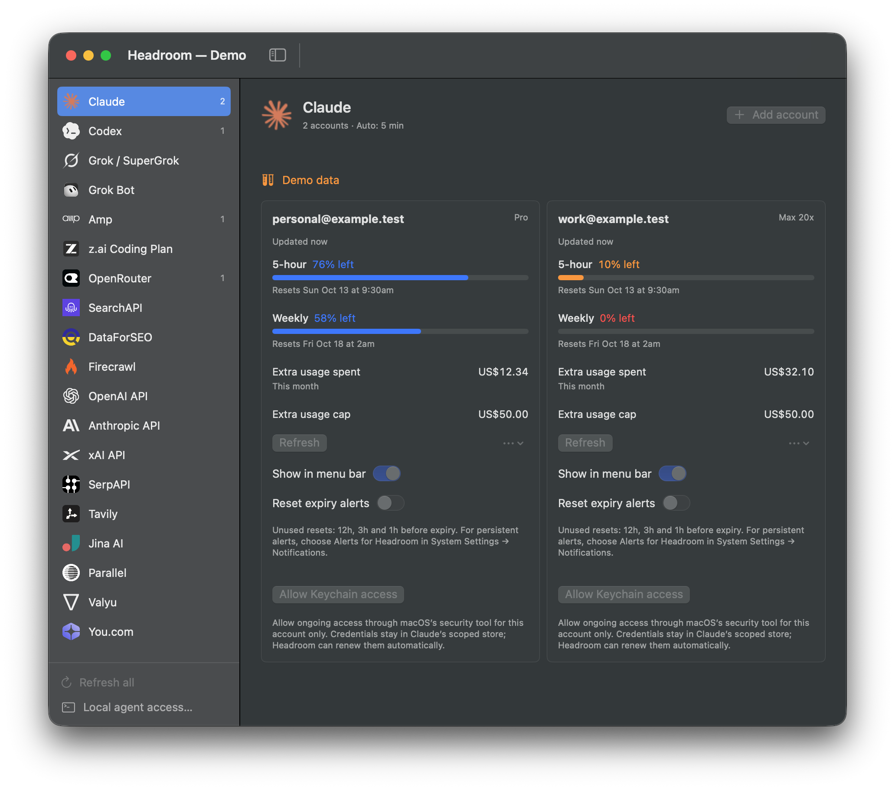

<p align="center">
  
</p>

<h1 align="center">Headroom</h1>

<p align="center">Usage and limits for your AI accounts, in the macOS menu bar.</p>

<p align="center">
  <a href="#build-and-try-it">Get started</a> ·
  <a href="docs/providers.md">Providers</a> ·
  <a href="docs/accounts.md">Account setup</a> ·
  <a href="docs/local-mcp.md">MCP</a> ·
  <a href="LICENSE">MIT license</a>
</p>

Connect multiple Claude and Codex accounts, even when they aren't signed in to your local CLIs. Keep subscription limits, reset times, and API balances together without opening each dashboard.

Headroom is a native SwiftUI/AppKit app. It's free and open source. **Build from source for now; there is no packaged, notarized release.**

## A look at the app

These screenshots use the built-in demo. All accounts and readings are synthetic.

### Menu bar

<p align="center">
  <a href="docs/images/menu-bar.png"></a>
</p>

### Account settings



## What it does

- Connect several accounts per provider, with separate credentials for each.
- Pin account logos and readings to the menu bar. A native menu groups all connected accounts by service.
- Compare accounts side by side in a resizable settings window.
- Read subscription quotas, API spend, and credit balances where providers expose them. Missing readings stay unavailable.
- Warn before unused Claude or Codex reset credits expire. Codex reset use requires confirmation.
- Let same-Mac agents query cached usage through an optional, read-only [MCP server](docs/local-mcp.md).

Claude, Codex, Grok / SuperGrok, Grok Bot, Amp, and z.ai Coding Plan have connectors, alongside OpenRouter and API billing services. Credential requirements and coverage vary. See the [provider reference](docs/providers.md) before creating a key.

## Build and try it

You need macOS 14 or later and **Xcode 26 or later**, selected with `xcode-select`. The app uses Swift 6 and Icon Composer assets. The build targets your Mac's architecture; a universal binary isn't produced.

The following commands build locally with an ad-hoc signature. They don't install an app. Demo mode uses temporary fixtures, with no sign-in, provider requests, or real-account access.

```sh
git clone https://github.com/jkudish/headroom.git
cd headroom
swift test
HEADROOM_SIGNING_IDENTITY=- bash scripts/build-app.sh
open -n .build/Headroom.app --args --demo
```

You should see a menu-bar item and an account window with demo accounts. Quit that demo instance before opening the app for normal use:

```sh
open .build/Headroom.app --args --window
```

Choose **Add account** in the service sidebar. Claude and Codex use their official CLI helpers for independent browser sign-in; those helpers must be installed separately. API connectors use the credential type listed in [Providers](docs/providers.md). Existing CLI logins and browser cookies aren't imported.

For a local installation, quit Headroom, then copy `.build/Headroom.app` to `~/Applications/`. Keep a single installed copy. Changing the signing identity or app location can require new Keychain approvals. See [Building and contributing](CONTRIBUTING.md).

## Before you connect accounts

Some connectors use private interfaces and can break when providers change them. Implemented support does not mean every provider has been verified with a live account. In particular, Amp's supplemental Orb query and Grok sign-in need further live verification.

Official helpers can request broad account permissions. Headroom is not a provider-approved third-party OAuth integration. Review the [credential and security boundaries](SECURITY.md) before signing in.

Headroom stores account data on your Mac and contacts providers for readings and authentication. It has no hosted Headroom backend. It doesn't enforce spending limits or replace provider billing dashboards.

## Help and contributing

- [Connect accounts and troubleshoot access](docs/accounts.md)
- [Provider coverage and credential types](docs/providers.md)
- [Reset credits and expiry alerts](docs/reset-credits.md)
- [Local MCP setup](docs/local-mcp.md)
- [Report a bug or request a feature](https://github.com/jkudish/headroom/issues)
- [Contribute](CONTRIBUTING.md) · [Security](SECURITY.md) · [Third-party notices](THIRD_PARTY_NOTICES.md)

## Sponsoring

If Headroom helps your work, consider [sponsoring its development](https://github.com/sponsors/jkudish).

Made by [Joey Kudish](https://github.com/jkudish). Headroom's code is [MIT-licensed](LICENSE); provider marks belong to their respective owners.
